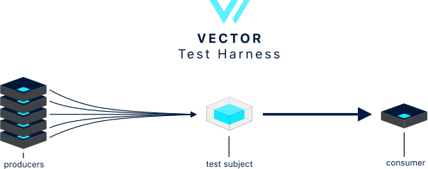

<p align="center">
  
</p>

# Vector Test Harness

A Rust command-line harness for Vector end-to-end correctness tests, performance
benchmarks, and profiling experiments. `vth` owns orchestration and analysis;
Terraform and Ansible define the existing remote environments and workloads.
The optional `justfile` provides convenient commands for the same Rust CLI.

> [!NOTE]
> The existing cases are under construction. Consolidating the runner does not
> validate old Vector configs, subject installers, or historical performance
> claims against current versions. Cloud and profiling validation still require
> the appropriate AWS account and Linux benchmark machines.

## Getting started

Install Rust 1.94+, Terraform 1.0+, Ansible 2.16+, and the AWS CLI. Packer is
needed for AMI builds; `just` is optional. See [the setup guide](docs/setup.md)
for AWS prerequisites and [the migration guide](docs/migration.md) for old commands.

```sh
cargo build --locked --bins
cargo run --locked --bin vth -- --help
just doctor
just list
```

All recipes delegate to Rust. Without `just`, use
`cargo run --locked --bin vth -- <command> ...`, or install the CLI with
`cargo install --locked --path . --bin vth`.

## Remote cases

Copy `.env.example` to `.env` and configure the account, buckets, SSH identity,
and user ID. Existing `VECTOR_TEST_*` variables remain supported. Explicit CLI
options take precedence over environment variables; the environment takes
precedence over `.env`. The harness parses `.env` as data and never executes
`.envrc` or shell commands in configuration. `--no-dotenv` disables loading.

```sh
just run -t tcp_to_tcp_performance -s vector -v 0.55.0
just run -t tcp_to_tcp_performance -s vector --run-only
just results -t tcp_to_tcp_performance
just compare -t tcp_to_tcp_performance -s vector -v 0.54.0 -v 0.55.0
just teardown -t tcp_to_tcp_performance --yes
```

`run` provisions with Terraform, bootstraps with Ansible, then runs the selected
subjects sequentially. `--bootstrap-only`, `--run-only`, and `--skip-terraform`
retain their previous meanings. Use `--vector-deb /path/to/vector.deb -v dev-name`
for a custom package. Versions must identify the tested artifact; `latest` is
rejected.

Resources and state remain scoped by case, configuration, and user ID. Both
creation and teardown initialize the same backend key. `--ssh-cidr` (or
`VECTOR_TEST_SSH_CIDR`) overrides automatic egress-IP detection.

Inspect the commands without running external tools or writing files:

```sh
just run -t tcp_to_tcp_performance -s vector --dry-run
just teardown -t tcp_to_tcp_performance --yes --dry-run
```

Dry runs produce JSON lines containing argv arrays and planned filesystem actions.
They still validate configuration and case files. AWS credentials are unnecessary
for dry runs. No provisioning is performed by the harness's own test suite.

Remote cases continue to run in isolated AWS environments. Performance
measurements should use controlled Linux benchmark machines.

## Results

`compare` uses the existing Athena query. `export` preserves the website's
`performance_tests` structure and publishes to `summaries/latest.json` unless
`--no-upload` is supplied. Athena failures and timeouts produce errors; all
result pages are read.

Offline analysis is available too:

```sh
just results -t tcp_to_tcp_performance --input /path/to/dstat.csv --json
just compare --input /path/to/athena-response.json
just export-results --input /path/to/athena-response.json --no-upload
```

The dstat summary retains the old positive-sample selection and warmup/tail
trimming. This migration does not change historical measurement formulas or
S3 partitions. S3 summaries identify configurations separately. Historical keys
contain no user ID, so `results --user-id` reports an error rather than silently
ignoring that filter.

Athena defaults remain database `vector_tests` and query output
`s3://vector-test-athena-results`. Override these with
`VECTOR_TEST_ATHENA_DATABASE` and `VECTOR_TEST_ATHENA_OUTPUT`.

## Standalone performance experiments

The old per-case build/profiling scripts now share Rust commands. Supply a binary
or build an explicit revision in an isolated clone. The build checks that Cargo
uses that clone's own `target` and records the resolved commit and build settings.

```sh
just build --revision <commit> --no-default-features --features sources-stdin,sinks-blackhole
just bench stdin_to_blackhole --vector-bin /path/to/vector --runs 10
just bench klog_remap_to_blackhole --vector-bin /path/to/candidate --baseline-bin /path/to/baseline
just profile klog_remap_to_blackhole --vector-bin /path/to/vector --tool perf
just flamegraph --input /path/to/profile.perf.data --baseline /path/to/baseline.perf.data
```

`bench` records each repetition, alternates baseline/candidate order, and writes
`benchmark.json` with artifact hashes and explicit measurement-method metadata.
These timings have a new method identity and must not be pooled with historical
hyperfine or dstat results. The archived case configs and fixtures retain their
original workload semantics; choose a compatible Vector binary or an explicit
`--config` when using them.

`profile` supports `perf`, `stat`, `massif`, and `dhat`. Profiling tools remain
external dependencies and generally require Linux. For the continuously running
file workload, use `generate --filegen-bin /path/to/file_gen` and
`profile file_to_blackhole --vector-bin /path/to/vector`. Generated logs are only
removed when `generate --reset-logs` is explicitly requested.

See [standalone workflows](cases/performance/README.md) for more examples.

## Development

```sh
just fmt
just check
just test
just lint
```

The Rust tests exercise command construction, remote lifecycle failures, Athena
pagination, CSV analysis, website exports, gzip input, and guest helpers using
local Rust test doubles. `lint` checks Terraform formatting separately.

Add remote cases under `cases/<name>/` with the existing `terraform/`, `ansible/`,
and `configurations/<variant>/` structure. The shared subject/version catalog is
in `config/subjects.json`, metric presentation metadata is in
`config/metrics.json`, and historical analysis queries are in `queries/`.

The small dependency-free `vth-guest` binary implements the VM's timed socat loop,
parallel argv execution, and Docker long-message fixture. AMI and fixture image
builds compile it from the same Rust source. **Rebuild the AMI before running
migrated cloud cases**, since older images only contain the shell helper.

## License

[MPL 2.0](LICENSE). Keep benchmark methods and modifications public so that results
can be reproduced and assessed.
